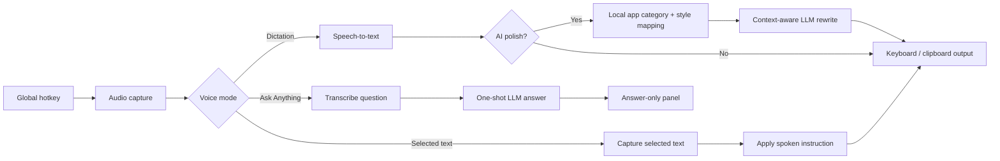
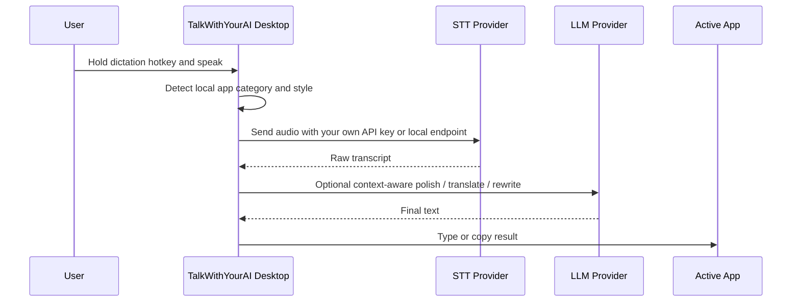
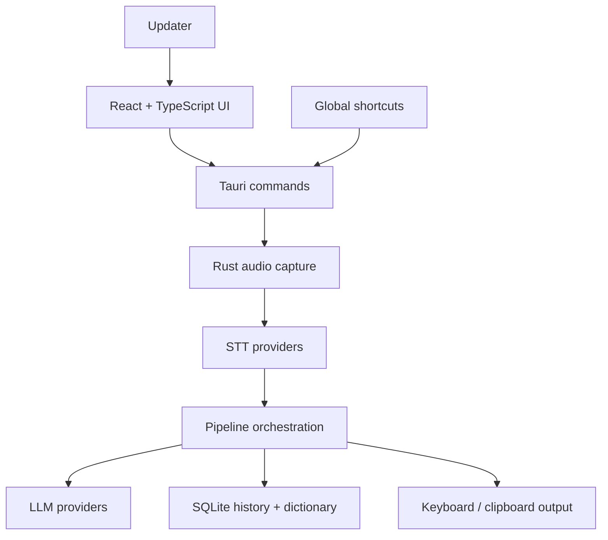

<p align="center">
  
</p>

<h1 align="center">TalkWithYourAI</h1>

<p align="center">
  Open-source alternative to Wispr Flow and Superwhisper for AI voice input, rewriting, and voice Q&A on macOS, Windows, and Linux.
</p>

<p align="center">
  Press a hotkey, speak naturally, and get clean text in the app you are already using.<br/>
  Or ask a one-shot voice question and get a concise AI answer without opening a chat app.
</p>

<p align="center">
  <a href="https://github.com/Mutantcat-Working-Group/TalkWithYourAI/actions/workflows/ci.yml"></a>
  <a href="LICENSE"></a>
</p>

<p align="center">
  <a href="https://github.com/Mutantcat-Working-Group/TalkWithYourAI/releases"><strong>Download</strong></a> ·
  <a href="#getting-started"><strong>Run locally</strong></a> ·
  <a href="#community"><strong>Issues</strong></a>
</p>

<p align="center">
  <strong>Dictate anywhere</strong> · <strong>Rewrite selected text</strong> · <strong>Ask one-shot voice questions</strong> · <strong>Bring your own keys</strong>
</p>

> **Fork notice:** TalkWithYourAI is based on [tover0314-w/opentypeless](https://github.com/tover0314-w/opentypeless), which is MIT licensed. This fork is local-only: the account, subscription, and managed-cloud layer has been removed, so the app runs without sign-in, without a backend service, and with only the API keys you configure yourself. See `LICENSE` and `THIRD_PARTY_NOTICES.md` for the retained upstream attribution.
>
> The upstream multilingual READMEs (Japanese, Korean, Spanish, French, German, Portuguese, Russian, Arabic, Hindi, Italian, Turkish, Vietnamese, Thai, Indonesian, Polish, Dutch) were removed along with the upstream content they documented. Only this file and [README_zh.md](README_zh.md) are maintained.

## Product Highlights

TalkWithYourAI understands more of the workflow around your voice, not only the words you said:

- **App-aware writing** detects the active application locally and adapts structure and tone for email, chat, documents, issue trackers, coding tools, and more.
- **Voice intent routing** distinguishes dictation, selected-text editing, translation, Ask Anything, and supported voice actions in English, Simplified Chinese, and Traditional Chinese.
- **Multiple shortcuts per workflow** let you assign and reorder more than one binding for Dictation, Ask Anything, and Translation.
- **Switchable translation targets** make it faster to move between the languages you use instead of keeping one fixed output language.
- **A stronger local dictionary** adds correction rules plus dictionary import/export, so recurring names, terminology, and transcription mistakes stay under your control.
- **Per-app style mappings** let you override the built-in app category when a detected app needs a different writing style.

All application detection, mappings, dictionary entries, correction rules, history, and scenes are stored locally in SQLite on your machine. App-aware polish sends only the internal app category and approved style metadata to the configured LLM path; raw window titles and document contents are not sent to the LLM or stored in history.

## Ask Anything

Ask Anything is a shortcut-first voice Q&A flow, not a chat tab. Press the Ask Anything hotkey, speak a question, stop recording, and TalkWithYourAI transcribes it, sends a one-shot request to the LLM, then shows only the final answer in a small floating note.

It is designed for quick answers with no chat history, no input box, and no extra send step. If selected-text context is enabled, Ask can also answer questions about the text currently selected in another app.

Default shortcuts follow the Typeless-style flow:

| Platform | Dictation | Ask Anything | Translate selected text |
| -------- | --------- | ------------ | ----------------------- |
| macOS    | `Fn`      | `Fn+Space`   | `Fn+LeftShift`          |
| Windows  | `Right Alt` | `Right Alt+Space` | `Right Alt+LeftShift` |
| Linux    | `Ctrl+/`  | `Ctrl+.`     | configurable            |

Linux keeps conservative Ctrl-based defaults because global Right Alt handling is less reliable across desktop environments, especially on Wayland.

## What TalkWithYourAI Does

TalkWithYourAI gives you four voice-first desktop workflows:

| Workflow              | What happens                                                                                                           |
| --------------------- | ---------------------------------------------------------------------------------------------------------------------- |
| Dictation             | Hold a hotkey, speak, transcribe, optionally polish with an LLM, then type or copy the result into the active app      |
| Ask Anything          | Start a one-shot voice question, transcribe it, send it to the LLM, and show only the final answer in a small panel    |
| Selected-text editing | Select text in another app, speak an instruction, and let the LLM rewrite, summarize, translate, or fix that selection |
| Translation           | Use a dedicated shortcut, speak or select text, and send the result to one of your configured target languages         |

Use it for emails, chat replies, meeting notes, issue comments, prompts, documentation drafts, quick answers, multilingual translation, and any workflow where speaking is faster than typing.



## Why TalkWithYourAI?

Most desktop dictation tools stop at transcription. TalkWithYourAI adds the AI rewrite layer, provider choice, and open-source control that power users need — with no account and no cloud layer to sign up for.

|                        | TalkWithYourAI                                                       | macOS Dictation | Windows Voice Typing | Whisper Desktop |
| ---------------------- | -------------------------------------------------------------------- | --------------- | -------------------- | --------------- |
| AI text polishing      | ✅ Multiple LLMs                                                     | ❌              | ❌                   | ❌              |
| Ask Anything voice Q&A | ✅                                                                   | ❌              | ❌                   | ❌              |
| STT provider choice    | ✅ Deepgram, AssemblyAI, Whisper-compatible, Doubao, Apple Speech, and more | ❌ Apple only   | ❌ Microsoft only    | ❌ Whisper only |
| Works in any app       | ✅                                                                   | ✅              | ✅                   | ❌ Copy-paste   |
| Translation mode       | ✅                                                                   | ❌              | ❌                   | ❌              |
| Selected-text rewrite  | ✅                                                                   | ❌              | ❌                   | ❌              |
| App-aware writing      | ✅ Local detection and mappings                                      | ❌              | ❌                   | ❌              |
| Multiple shortcuts     | ✅ Per voice workflow                                                 | ❌              | ❌                   | ❌              |
| No account required    | ✅                                                                   | ✅              | ✅                   | ✅              |
| Open source            | ✅ MIT                                                               | ❌              | ❌                   | ✅              |
| Cross-platform         | ✅ Win/Mac/Linux                                                     | ❌ Mac only     | ❌ Windows only      | ✅              |
| Custom dictionary      | ✅                                                                   | ❌              | ❌                   | ❌              |
| Bring your own keys    | ✅ BYOK                                                              | ❌              | ❌                   | ✅              |

## Features

| Area              | Highlights                                                                                                                                  |
| ----------------- | ------------------------------------------------------------------------------------------------------------------------------------------- |
| Voice capture     | Native Fn / Right Alt hotkeys on macOS/Windows, Linux Ctrl defaults, multiple bindings per workflow, hold or toggle mode, floating capsule states, idle auto-hide |
| AI rewriting      | App-aware writing, local per-app style mappings, polish styles, streaming polish, selected-text context, and custom instructions             |
| Ask Anything      | One-shot voice question flow: record in the capsule, think, then show a small answer note with copy support                                 |
| Voice actions     | Deterministic English, Simplified Chinese, and Traditional Chinese routing for editing, translation, Ask, and supported actions              |
| STT providers     | Apple Speech on macOS, Deepgram, AssemblyAI, GLM-ASR, OpenAI Whisper, Groq Whisper, SiliconFlow, Volcengine Doubao, custom/local endpoints |
| LLM providers     | OpenAI-compatible APIs including OpenAI, DeepSeek, Claude via OpenRouter, Gemini, Groq, Qwen, Moonshot, Anthropic, Ollama, and more       |
| Output            | Keyboard simulation, clipboard paste/copy-only, Windows SendInput, clipboard restore, and output-failure diagnostics                       |
| Language          | Auto-detect speech, dedicated translation shortcut, switchable target languages, and 20+ translation targets                                |
| Dictionary        | Custom terms, import/export, and local correction rules for recurring transcription mistakes                                                 |
| Scenes            | Built-in scenes, local custom scenes, active scene metadata, import/export for reusable writing styles                                      |
| Privacy           | Local app detection and mappings, provider keys in the OS credential vault where available, no telemetry, no account                      |
| Desktop polish    | Dark/light/system theme, onboarding, local history search, auto-start, GitHub release notifications, cross-platform Tauri app                                |

UI localization ships with complete English and Chinese copy, plus additional locale files that may still fall back to English for newer advanced features.

## How The App Thinks



> [!TIP]
> **Recommended Configuration for Best Experience**
>
> |              | Provider | Model                    |
> | ------------ | -------- | ------------------------ |
> | 🗣️ STT       | Groq     | `whisper-large-v3-turbo` |
> | 🤖 AI Polish | Google   | `gemini-2.5-flash`       |
>
> This combo delivers fast, accurate transcription with high-quality text polishing — and both offer generous free tiers.

## Try It in 5 Minutes

1. Download the latest build for your platform from [Releases](https://github.com/Mutantcat-Working-Group/TalkWithYourAI/releases).
2. Open the app — there is no sign-in step; go straight to Settings.
3. Pick speech recognition and AI polish providers and enter your own API keys.
4. Set one or more shortcuts for Dictation, Ask Anything, and Translation.
5. Open any desktop app, press the hotkey, speak, and let TalkWithYourAI type the polished result.

## Download

Download the latest version for your platform:

**[Download the latest release](https://github.com/Mutantcat-Working-Group/TalkWithYourAI/releases/latest)**

| Platform | File                                         |
| -------- | -------------------------------------------- |
| Windows  | NSIS `.exe` installer                        |
| macOS    | Universal `.dmg` for Apple Silicon and Intel |
| Linux    | `.AppImage` / `.deb`                         |

Release versions use a date-based scheme: `1.0.YYYYMMDD` (for example `1.0.20261120`).

## Installation Notes

Release builds are produced by [`.github/workflows/release.yml`](.github/workflows/release.yml). Always download from this repository's [GitHub Releases](https://github.com/Mutantcat-Working-Group/TalkWithYourAI/releases) page.

macOS builds are **ad-hoc signed**, not Developer-ID signed and not notarized. Gatekeeper will still warn on first launch — right-click the app and choose **Open**, or run `xattr -dr com.apple.quarantine /Applications/TalkWithYourAI.app`.

**There is no signed auto-update.** The macOS build is ad-hoc signed and this project has no maintainer signing key, so an update payload could never be verified. Instead the app asks the public GitHub Releases API whether a newer tag exists and shows a notice with a link to the release page; you download and install the new version yourself. Nothing is downloaded or executed automatically.

### Windows

Windows SmartScreen may show "Windows protected your PC":

1. Click **More info**
2. Click **Run anyway**

If the installer shows a publisher validation warning:

1. Right-click the `.msi` file → **Properties**
2. Check **Unblock** at the bottom → **Apply**
3. Run the installer again

### macOS

macOS builds are Developer ID signed. If Gatekeeper still blocks first launch while notarization/stapling catches up, remove the quarantine attribute:

```bash
xattr -cr /Applications/TalkWithYourAI.app
```

Then open the app normally.

### Linux

**Ubuntu/Debian** — install the `.deb` package:

```bash
sudo apt install ./TalkWithYourAI_1.0.20261120_amd64.deb
```

**AppImage** — make it executable and run:

```bash
chmod +x TalkWithYourAI_1.0.20261120_amd64.AppImage
./TalkWithYourAI_1.0.20261120_amd64.AppImage
```

**NVIDIA + Wayland users:** The app auto-detects this configuration and applies a workaround. If it still crashes on startup, run:

```bash
WEBKIT_DISABLE_DMABUF_RENDERER=1 ./TalkWithYourAI
```

The bundled Linux workarounds can also be forced with these environment variables. The `TALKWITHYOURAI_*` names are preferred; the older `OPENTYPELESS_*` names are still read as upstream compatibility aliases:

| Preferred name | Compatibility alias |
| -------------- | ------------------- |
| `TALKWITHYOURAI_DISABLE_WEBKIT_DMABUF` | `OPENTYPELESS_DISABLE_WEBKIT_DMABUF` |
| `TALKWITHYOURAI_DISABLE_WEBKIT_COMPOSITING` | `OPENTYPELESS_DISABLE_WEBKIT_COMPOSITING` |
| `TALKWITHYOURAI_FORCE_GDK_X11` | `OPENTYPELESS_FORCE_GDK_X11` |
| `TALKWITHYOURAI_FORCE_SOFTWARE_GL` | `OPENTYPELESS_FORCE_SOFTWARE_GL` |

**Wayland users:** the required helper depends on the compositor:

- KDE Plasma/KWin Wayland uses [`kwtype`](https://github.com/Sporif/KWtype), which must currently be built and installed using the upstream instructions.
- Other Wayland compositors use `wtype`. On Ubuntu/Debian run `sudo apt install wtype`; on Arch/Manjaro run `sudo pacman -S wtype`.

Global hotkeys can still depend on the desktop environment. If the matching helper is unavailable or fails, TalkWithYourAI keeps the result in the clipboard instead of running an untrusted user script.

## Prerequisites

- [Node.js](https://nodejs.org/) 20+
- [Rust](https://rustup.rs/) (stable toolchain)
- Platform-specific dependencies for Tauri: see [Tauri Prerequisites](https://v2.tauri.app/start/prerequisites/)

## Getting Started

```bash
# Install dependencies
npm install

# Run in development mode
npm run tauri dev

# Build for production
npm run tauri build
```

The built application will be in `src-tauri/target/release/bundle/`.

## Configuration

All settings are accessible from the in-app Settings panel:

- **Speech Recognition** — choose STT provider and enter your API key, base URL, and model
- **AI Polish** — choose an LLM provider and model, enable app-aware writing, manage per-app style mappings, and configure selected-text context
- **General** — manage multiple Dictation, Ask Anything, and Translation shortcuts, output mode, auto-start, and idle capsule visibility
- **Dictionary** — add or import custom terms, export your dictionary, and create local correction rules for recurring transcription mistakes
- **Scenes** — built-in and local prompt templates with import/export for reusable writing styles
- **About** — version, repository, and license information

API keys are stored locally in the OS credential vault where available, with a local fallback for unsupported environments. Keys are never sent anywhere except the provider you configure — STT/LLM requests go directly from your machine to that provider.

### Local only

TalkWithYourAI has no accounts, no subscriptions, and no managed cloud. Everything runs on your machine:

1. Choose any STT and LLM provider in Settings
2. Enter your own API keys (or point at a local endpoint such as Ollama or a self-hosted Whisper server)
3. That's it — history, dictionaries, correction rules, scenes, and app mappings are stored in a local SQLite database, and no request goes anywhere except the providers you chose

If you want to run without any network connection at all, use a local Whisper-compatible STT endpoint together with a local OpenAI-compatible LLM such as Ollama.

## Migrating From A Previous Installation

The bundle identifier, product name, keyring service name, and database filename all changed compared with the app this fork is based on, so the two are independent applications. Nothing is inherited automatically, and both can be installed side by side.

To bring your data across:

- **History, dictionary, scenes:** copy the old SQLite database file from the previous app's data directory into the new app's data directory, and rename it to the new database filename (`talkwithyourai.db`). Dictionaries and scenes can also be exported and re-imported from the app.
- **Settings:** `tauri-plugin-store` also keeps a `settings.json` in the same data directory (app config, window geometry, and the `onboarding_completed` flag). Copy it across too, or accept running through onboarding again and losing the saved window position.
- **API keys:** keys are stored in the OS keyring under the app's service name, which changed. Enter your API keys again in the new app — they do not follow automatically.

## Architecture

**Desktop pipeline:**



```
src/                  # React frontend (TypeScript)
├── components/       # UI components (Settings, History, Capsule, etc.)
├── hooks/            # React hooks (recording, theme, Tauri events)
├── lib/              # Utilities (provider clients, router, constants)
└── stores/           # Zustand state management

src-tauri/src/        # Rust backend
├── audio/            # Audio capture via cpal
├── stt/              # STT providers (Deepgram, AssemblyAI, Whisper-compat, Apple Speech)
├── llm/              # LLM providers (OpenAI-compat and native)
├── output/           # Text output (keyboard simulation, clipboard paste)
├── storage/          # Config (tauri-plugin-store) + history/dictionary (SQLite)
├── app_detector/     # Detect active application for context
├── pipeline.rs       # Recording → STT → LLM → Output orchestration
└── lib.rs            # Tauri app setup, commands, hotkey handling
```

## Roadmap

- [ ] Usage summary UI for aggregate audio time and word counts
- [ ] More provider-specific setup diagnostics
- [ ] Better Linux desktop-environment guidance
- [ ] More workflow presets for writing, coding, and support replies
- [ ] Plugin-style provider extensions
- [x] A release pipeline for this repository (`.github/workflows/release.yml`, three platforms)

## FAQ

**Is my audio sent anywhere besides my provider?**
Audio goes directly from your machine to the STT provider (or local endpoint) you configured. Nothing passes through any server operated by this project — the app has no backend at all.

**Can I use it offline?**
With a local Whisper-compatible STT endpoint and a local OpenAI-compatible LLM such as Ollama, the app can run without any network connection.

**Which languages are supported?**
STT supports 99+ languages depending on the provider. AI polish and translation support 20+ target languages.

**Is the app free?**
Yes. The app is fully functional with your own API keys. There is no paid tier, subscription, or account.

**Do I need to sign in?**
No. There is no account system. The first launch takes you straight to provider configuration.

## Community

- 🐛 [Issue Tracker](https://github.com/Mutantcat-Working-Group/TalkWithYourAI/issues) — Bug reports and feature requests
- 📖 [Contributing Guide](CONTRIBUTING.md) — Development setup and guidelines
- 🔒 [Security Policy](SECURITY.md) — Report vulnerabilities responsibly
- 🧭 [Vision](VISION.md) — Project principles and roadmap direction

## Contributing

Contributions are welcome! See [CONTRIBUTING.md](CONTRIBUTING.md) for development setup and guidelines.

## Built With

- [Tauri](https://tauri.app/) for the desktop shell
- [React](https://react.dev/) and [TypeScript](https://www.typescriptlang.org/) for the UI
- [Rust](https://www.rust-lang.org/) for audio capture, providers, hotkeys, output, and local storage
- [i18next](https://www.i18next.com/) for multilingual UI

## License

[MIT](LICENSE). The original copyright notice of the upstream project this fork is based on is retained in `LICENSE` and `THIRD_PARTY_NOTICES.md` as required by the MIT license.
