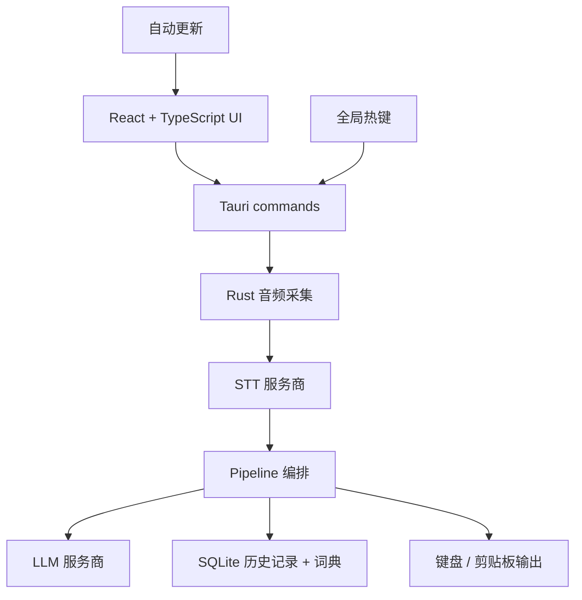

<p align="center">
  
</p>

<h1 align="center">TalkWithYourAI</h1>

<p align="center">
  开源版 Wispr Flow / Superwhisper：面向 macOS、Windows 和 Linux 的 AI 语音输入、改写和语音问答工具。
</p>

<p align="center">
  无论你在写邮件、写代码、聊天还是做笔记 — 只需按下热键，<br/>
  说出你的想法，TalkWithYourAI 会用 AI 转录并润色你的语音，<br/>
  然后直接输入到你正在使用的任何应用中。
</p>

<p align="center">
  <a href="https://github.com/Mutantcat-Working-Group/TalkWithYourAI/actions/workflows/ci.yml"></a>
  <a href="LICENSE"></a>
</p>

<p align="center">
  <strong>任意应用听写</strong> · <strong>改写选中文本</strong> · <strong>语音 Ask 一次性问答</strong> · <strong>自备 API 密钥</strong>
</p>

> **Fork 说明：** TalkWithYourAI 基于 [tover0314-w/opentypeless](https://github.com/tover0314-w/opentypeless)（MIT 许可）修改而来。本分支只做本地运行：账号、订阅和托管云端这一整层已被移除，应用无需登录、不依赖任何后端服务，语音识别与 AI 润色只使用你自己配置的 API 密钥。原版权声明保留在 `LICENSE` 与 `THIRD_PARTY_NOTICES.md` 中。
>
> 上游的多语言 README（日语、韩语、西班牙语、法语、德语、葡萄牙语、俄语、阿拉伯语、印地语、意大利语、土耳其语、越南语、泰语、印尼语、波兰语、荷兰语）已随上游内容一并删除。本仓库此后只维护本文件与 [README.md](README.md) 两份。

## 产品亮点

- **应用感知写作**会在本地识别当前应用，并针对邮件、聊天、文档、Issue 跟踪、开发工具等场景调整结构和语气。
- **语音意图路由**可区分普通听写、选中文本编辑、翻译、Ask Anything 和受支持的语音操作，并支持简体中文、繁体中文和英文。
- **每个工作流支持多个快捷键**，可为听写、Ask Anything 和翻译分别添加和排序多个按键组合。
- **可切换翻译目标语言**，无需始终固定为同一种输出语言。
- **更完整的本地词典**支持纠错规则以及词典导入导出。
- **按应用设置写作风格**，可覆盖内置应用分类，为特定应用指定其他写作场景。

应用识别、映射、词典、纠错规则、历史记录和场景都保存在本机 SQLite 中。应用感知润色只会向配置的 LLM 发送内部应用分类和经过审核的风格元数据；原始窗口标题和文档内容不会作为应用上下文发送，也不会写入历史记录。


---

## Ask Anything

Ask Anything 不是聊天页，也不是另一个输入框。它是一个快捷键优先的语音问答流程：按下 Ask 热键，说出问题，停止录音后，TalkWithYourAI 会先转写问题，再调用 LLM，最后只把答案显示在一个小便签里。

它适合临时问一句、快速查一句、让 AI 根据当前选中文本解释/总结/改写一句。默认没有聊天历史、没有输入框、没有额外发送按钮，结果可以直接复制。

默认热键对齐 Typeless 风格：

| 平台 | 听写 | Ask Anything | 翻译选中文本 |
|---|---|---|---|
| macOS | `Fn` | `Fn+Space` | `Fn+LeftShift` |
| Windows | `Right Alt` | `Right Alt+Space` | `Right Alt+LeftShift` |
| Linux | `Ctrl+/` | `Ctrl+.` | 可配置 |

Linux 暂时保持 `Ctrl+/` 和 `Ctrl+.` 作为默认热键，因为不同桌面环境，尤其是 Wayland 下，全局 `Right Alt` 监听不如 Windows 稳定。

## 为什么选择 TalkWithYourAI？

| | TalkWithYourAI | macOS 听写 | Windows 语音输入 | Whisper Desktop |
|---|---|---|---|---|
| AI 文本润色 | ✅ 多种 LLM | ❌ | ❌ | ❌ |
| Ask Anything 语音问答 | ✅ | ❌ | ❌ | ❌ |
| STT 服务商选择 | ✅ Deepgram、AssemblyAI、Whisper 兼容、Doubao、Apple Speech 等 | ❌ 仅 Apple | ❌ 仅 Microsoft | ❌ 仅 Whisper |
| 适用于任意应用 | ✅ | ✅ | ✅ | ❌ 需复制粘贴 |
| 翻译模式 | ✅ | ❌ | ❌ | ❌ |
| 选中文本改写 | ✅ | ❌ | ❌ | ❌ |
| 应用感知写作 | ✅ 本地识别与映射 | ❌ | ❌ | ❌ |
| 多快捷键 | ✅ 按工作流分别配置 | ❌ | ❌ | ❌ |
| 无需账号 | ✅ | ✅ | ✅ | ✅ |
| 开源 | ✅ MIT | ❌ | ❌ | ✅ |
| 跨平台 | ✅ Win/Mac/Linux | ❌ 仅 Mac | ❌ 仅 Windows | ✅ |
| 自定义词典 | ✅ | ❌ | ❌ | ❌ |
| 自备密钥 | ✅ BYOK | ❌ | ❌ | ✅ |

## 功能特性

- 🎙️ 默认对齐 Typeless 风格热键：macOS `Fn`，Windows `Right Alt`，Linux `Ctrl+/`
- ❓ 独立 Ask Anything 热键：macOS `Fn+Space`，Windows `Right Alt+Space`，Linux `Ctrl+.`
- 💊 浮动胶囊显示准备、录音、转写、润色、Ask thinking 等状态，空闲时可自动隐藏
- 🗣️ 接入 6+ 语音识别服务商，并支持 macOS Apple Speech 与自托管 Whisper 兼容端点
- 🤖 多种大模型润色文本：OpenAI、DeepSeek、Claude、Gemini、Ollama 等
- ✨ 润色风格：轻改、清爽、结构化、专业
- ⚡ 流式输出，边生成边打字
- ⌨️ 支持键盘模拟、剪贴板粘贴/仅复制、Windows SendInput 和输出失败诊断
- 📝 Ask/润色可读取选中文本，用来提问、总结、改写或翻译
- 🌐 翻译模式：说中文，输出英文（或其他 20+ 语言）
- 📖 自定义词典和本地纠错规则，提升专业术语与常见错词处理
- 🧩 内置场景、本地自定义场景、导入导出和激活状态
- 🔐 API 密钥优先存入系统密钥库，尽量避免明文保存在配置里
- 🔍 自动识别当前应用，适配不同场景
- 📜 本地历史记录，支持全文搜索
- 🌗 深色 / 浅色 / 跟随系统主题
- 🚀 开机自启

> 界面本地化目前以英文和中文最完整；其他语言包已覆盖 key，但部分新功能和高级设置仍可能回退显示英文。

> [!TIP]
> **推荐配置（开箱即用最佳体验）**
>
> | | 服务商 | 模型 |
> |---|---|---|
> | 🗣️ 语音识别 | Groq | `whisper-large-v3-turbo` |
> | 🤖 AI 润色 | Google | `gemini-2.5-flash` |
>
> 这套组合转录速度快、准确率高，文本润色质量出色，而且两者都提供慷慨的免费额度。

## 下载安装

下载适用于你平台的最新版本：

**[下载最新正式版](https://github.com/Mutantcat-Working-Group/TalkWithYourAI/releases/latest)**

| 平台 | 文件 |
|------|------|
| Windows | NSIS `.exe` 安装程序 |
| macOS | Apple Silicon 和 Intel 通用 `.dmg` |
| Linux | `.AppImage` / `.deb` |

版本号采用日期式格式：`1.0.YYYYMMDD`（例如 `1.0.20261111`）。

## 安装说明

发布包由 [`.github/workflows/release.yml`](.github/workflows/release.yml) 生成。请始终从本仓库的 [GitHub Releases](https://github.com/Mutantcat-Working-Group/TalkWithYourAI/releases) 下载。

macOS 构建为 **ad-hoc 签名**，既不是 Developer ID 签名，也没有经过公证，Gatekeeper 仍会在首次启动时拦截 —— 右键应用选择**打开**，或执行：

```bash
xattr -dr com.apple.quarantine /Applications/TalkWithYourAI.app
```

自动更新产物需要 minisign 密钥。在把 `TAURI_SIGNING_PRIVATE_KEY`（及 `TAURI_SIGNING_PRIVATE_KEY_PASSWORD`）配置为仓库 secrets、**并且**用配套公钥替换 `src-tauri/tauri.conf.json` 里的 `pubkey` 之前，workflow 会以关闭 `createUpdaterArtifacts` 的方式构建，不发布更新签名。配置里现有的 `pubkey` 属于上游原作者，保留它意味着第三方可以签出本应用会接受的更新，因此首次公开发布前必须替换。

### Windows

如果 Windows SmartScreen 提示“Windows 已保护你的电脑”：

1. 点击 **更多信息**
2. 点击 **仍要运行**

如果安装包出现发布者验证提示：

1. 右键 `.msi` 文件，选择 **属性**
2. 勾选底部的 **解除锁定**，点击 **应用**
3. 重新运行安装包

### macOS

macOS 构建为 ad-hoc 签名，首次启动会被 Gatekeeper 拦截。右键应用选择**打开**，或执行：

```bash
xattr -dr com.apple.quarantine /Applications/TalkWithYourAI.app
```

然后正常打开应用。

### Linux

**Ubuntu/Debian** 安装 `.deb`：

```bash
sudo apt install ./TalkWithYourAI_1.0.20261111_amd64.deb
```

**AppImage** 直接运行：

```bash
chmod +x TalkWithYourAI_1.0.20261111_amd64.AppImage
./TalkWithYourAI_1.0.20261111_amd64.AppImage
```

**NVIDIA + Wayland 用户：**应用会自动识别并应用兼容处理。如果仍然启动崩溃，可以尝试：

```bash
WEBKIT_DISABLE_DMABUF_RENDERER=1 ./TalkWithYourAI
```

Linux 兼容开关也可以用以下环境变量强制开启。优先读取 `TALKWITHYOURAI_*` 新名称；旧的 `OPENTYPELESS_*` 名称仍作为上游兼容别名继续生效：

| 首选名称 | 兼容别名 |
| --- | --- |
| `TALKWITHYOURAI_DISABLE_WEBKIT_DMABUF` | `OPENTYPELESS_DISABLE_WEBKIT_DMABUF` |
| `TALKWITHYOURAI_DISABLE_WEBKIT_COMPOSITING` | `OPENTYPELESS_DISABLE_WEBKIT_COMPOSITING` |
| `TALKWITHYOURAI_FORCE_GDK_X11` | `OPENTYPELESS_FORCE_GDK_X11` |
| `TALKWITHYOURAI_FORCE_SOFTWARE_GL` | `OPENTYPELESS_FORCE_SOFTWARE_GL` |

**Wayland 用户：**安装 `wtype` 后，TalkWithYourAI 可以把结果直接输入当前应用。Ubuntu/Debian 使用 `sudo apt install wtype`，Arch/Manjaro 使用 `sudo pacman -S wtype`。全局热键仍可能受桌面环境限制；如果未安装 `wtype`，TalkWithYourAI 会退回为复制结果到剪贴板。

## 前置要求

- [Node.js](https://nodejs.org/) 20+
- [Rust](https://rustup.rs/)（stable 工具链）
- Tauri 平台依赖：参见 [Tauri 前置要求](https://v2.tauri.app/start/prerequisites/)

## 快速开始

```bash
# 安装依赖
npm install

# 开发模式运行
npm run tauri dev

# 构建生产版本
npm run tauri build
```

构建产物位于 `src-tauri/target/release/bundle/`。

## 配置

所有设置均可在应用内的设置面板中访问：

- **语音识别** — 选择 STT 服务商并输入 API 密钥、base URL 和模型
- **AI 润色** — 选择 LLM 服务商、模型、API 密钥、润色风格、自定义提示词、翻译和选中文本上下文
- **通用** — 听写热键、Ask 热键、输出模式、开机自启和胶囊空闲隐藏
- **词典** — 添加自定义术语和本地纠错规则
- **场景** — 内置/本地提示词模板，支持导入导出
- **关于** — 版本号、仓库地址和许可信息

API 密钥会优先存入系统密钥库，不支持时使用本地 fallback。密钥不会发送到本项目的任何服务器 — 所有 STT/LLM 请求都直接从你的机器发送到你配置的服务商。

### 仅本地运行

TalkWithYourAI 没有账号、没有订阅、也没有托管云端。一切都在你的机器上运行：

1. 在设置中选择任意 STT 和 LLM 服务商
2. 输入你自己的 API 密钥（或指向本地端点，例如 Ollama 或自建 Whisper 服务）
3. 完成 — 历史记录、词典、纠错规则、场景和应用映射都保存在本机 SQLite 中，除了你选择的服务商之外不会发出任何请求

如果想完全不联网运行，可以配合本地 Whisper 兼容 STT 端点和本地 OpenAI 兼容 LLM（如 Ollama）使用。

## 从旧安装迁移

bundle identifier、产品名、keyring 服务名和数据库文件名都已变更，因此本应用与本分支所基于的旧版本是两个独立的应用。数据不会自动继承，两者可以同时安装、互不干扰。

迁移方式：

- **历史 / 词典 / 场景**：把旧应用数据目录中的 SQLite 文件复制到新应用数据目录，并改名为新数据库文件名（`talkwithyourai.db`）。词典和场景也可以在应用内导出后重新导入。
- **设置**：`tauri-plugin-store` 的 `settings.json` 同样位于应用数据目录，里面存有应用配置、窗口位置和 `onboarding_completed` 标记。建议一并复制，否则需要重新走一遍引导页并丢失窗口位置。
- **API 密钥**：密钥保存在系统密钥库中，服务名已变更，因此不会自动跟随。请在新应用里重新填写。

## 架构

**桌面端 Pipeline：**



```
src/                  # React 前端（TypeScript）
├── components/       # UI 组件（Settings、History、Capsule 等）
├── hooks/            # React hooks（录音、主题、Tauri 事件）
├── lib/              # 工具库（服务商客户端、路由、常量）
└── stores/           # Zustand 状态管理

src-tauri/src/        # Rust 后端
├── audio/            # 音频采集（cpal）
├── stt/              # STT 服务商（Deepgram、AssemblyAI、Whisper 兼容、Apple Speech）
├── llm/              # LLM 服务商（OpenAI 兼容与原生接口）
├── output/           # 文本输出（键盘模拟、剪贴板粘贴）
├── storage/          # 配置（tauri-plugin-store）+ 历史/词典（SQLite）
├── app_detector/     # 检测当前活动应用
├── pipeline.rs       # 录音 → STT → LLM → 输出 编排
└── lib.rs            # Tauri 应用设置、命令、热键处理
```

## 路线图

- [ ] 用量统计 UI：汇总音频时长和字数消耗
- [ ] 更细的服务商配置诊断
- [ ] 更清晰的 Linux 桌面环境兼容说明
- [ ] 更多工作流预设：写作、代码、客服回复等
- [ ] 插件式服务商扩展
- [ ] 本仓库的发版流水线（自动更新 endpoint 已指向本仓库，发版流程是后续任务）

## 常见问题

**我的音频会被发到服务商以外的地方吗？**
音频直接从你的机器发送到你配置的 STT 服务商或本地端点，不经过本项目运营的任何服务器 — 应用本身不含任何后端。

**可以离线使用吗？**
配合本地 Whisper 兼容 STT 端点和本地 OpenAI 兼容 LLM（如 Ollama），应用可以完全不联网工作。

**支持哪些语言？**
STT 根据服务商不同支持 99+ 种语言。AI 润色和翻译支持 20+ 种目标语言。

**应用免费吗？**
是的。使用自己的 API 密钥即可完整使用所有功能，没有付费档位、订阅或账号。

**需要登录吗？**
不需要。应用没有账号系统，首次启动直接进入服务商配置流程。

## 社区

- 🐛 [Issue Tracker](https://github.com/Mutantcat-Working-Group/TalkWithYourAI/issues) — Bug 报告和功能请求
- 📖 [贡献指南](CONTRIBUTING.md) — 开发环境搭建和贡献规范
- 🔒 [安全策略](SECURITY.md) — 负责任地报告漏洞
- 🧭 [愿景](VISION.md) — 项目原则和路线图方向

## 贡献

欢迎贡献！请参阅 [CONTRIBUTING.md](CONTRIBUTING.md) 了解开发设置和指南。

## 许可证

[MIT](LICENSE)。按 MIT 许可要求，本项目所基于的上游项目的原版权声明保留在 `LICENSE` 与 `THIRD_PARTY_NOTICES.md` 中。
